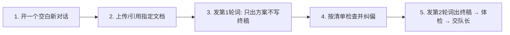

# 《一条截图》队友专属 · AI Agent 协作实操说明书

> **写给队友的话**：你完全不需要懂代码，也不需要会改程序！  
> 我们的项目已经做好了**“文字/图片与程序彻底分离”**的结构：你负责用 AI 产出高质量的**三视角教育文案、19 张统一画风插画、视听情绪分镜与实机验收**；队长负责把你的成果一键装进游戏并上线。  
> 只要严格按本说明书的**「开新对话 → 喂文档 → 复制提示词 → 逐条检查 → 打包交付」**五步走，你就是最顶级的 AI 协作者！

---

## 〇、开工前必读：绝对不能踩的 4 条红线

1. **绝不直接修改游戏主程序文件**：不要碰 `src/core/`、`src/world/`、`src/scenes3d/` 和 `src/ui/` 里的代码，也**绝对不要改写已有的 2D 手机原稿台词**。
2. **绝不出现真实信息**：文案和图片里严禁出现真实校名、真实人名、真实 App 名称（❌ 微信/微博/抖音/小红书/贴吧 → ✅ 群聊/校园墙/私信/平台）。
3. **内容克制红线**：严禁出现具体辱骂脏话、自伤暗示；严禁在给玩家看的界面中出现“得分、伤害值、信任值、正确率、对/错”等评判词汇。
4. **保护积分与效率**：**一件事开一个新对话**；如果 AI 连续 **2 轮**改不到位，**立刻放弃当前窗口、开新对话重写提示词**，绝对不要跟 AI 吵架 10 轮。

---

## 一、通用标准流程（每次让 AI 干活都按这 5 步）



- **什么时候必须开新对话？**
  - 从“写文案”切换到“写生图词”或“写分镜”时 → **必须开新对话**；
  - 同一个对话已经来回超过 **8~10 轮**，感觉 AI 开始忘事或变啰嗦 → **必须开新对话**；
  - AI 已经改歪了，连改 2 次还是不对 → **必须开新对话**。

---

## 二、任务一：让 Agent 帮你写《三视角科学抵制网暴》与《阿远的备忘录》（剧情与教育内核升级）

> **目标**：把我们作品的教育意义从“呼吁不要网暴”升级为 **Hack4Good（技术向善）** 冠军水准——从**受害者、旁观者、施害者/无意推手**三个视角，教大家遇到校园网暴时**具体怎么科学抵制、怎么合法留证、怎么有效止损**。

### Step 1：开对话 & 选择工具
- 打开 **Qoder（仅聊天模式，不要让它改代码）** 或你常用的主力对话 AI（如通义千问 / Claude / Gemini / ChatGPT）。
- 点击 **「新建对话（New Chat）」**。

### Step 2：开局必须喂给 AI 的 3 份文档（缺一不可，也别多塞）
把项目里以下 **3 个文件** 上传给 AI（如果在 Qoder 里，直接输入 `@` 选中这 3 个文件）：
1. `AGENTS.md` —— 让 AI 死死记住所有内容与合规红线；
2. `src/data/endingContent.ts` —— 让 AI 模仿我们原作**克制、温柔、不说教**的独特文风，并对齐 5 个结局；
3. `src/data/story.ending.ts` —— 让 AI 了解终章里林夏、阿远和主角的真实状态，防止胡编穿帮。

### Step 3：发送【第 1 轮提示词】（只看提纲，先不写全文）

直接复制下面整段发给 AI：

```text
请先仔细阅读我发给你的 3 个文件（AGENTS.md、endingContent.ts、story.ending.ts）。
不要修改任何代码文件，也不要直接写最终正文。

【背景与目标】
我们正在将反网络暴力互动叙事游戏《一条截图》提交至 Hack4Good（技术向善）赛道。
目前结局页的“行动卡片”只有 5 条静态文字且偏单一旁观者视角。我们希望升级为“三视角正向抵制工具箱”，不仅让人共情，更要教人“如何科学抵制、自护与止损”。

【本轮任务：先输出规划提纲】
请针对以下 4 个板块，用简短的提纲告诉我你的设计思路（每个板块 3-5 个要点即可）：
1. 【受害者视角（林夏）· 冷静自护与合法反制】：包含拒绝自证陷阱、合法固定证据四要素、社交降噪隔离、构建现实托底求助。
2. 【旁观者视角（主角/玩家）· 5D 科学正向干预法】：对应 Direct(理性澄清)、Distract(降温转移)、Delegate(寻求师长与平台介入，拒绝以暴制暴挂人)、Delay(私下温和陪伴)、Document(先问意愿再协助留证)。
3. 【施害者/无意推手视角（阿远/随手转发者）· 识别无意之恶与止损纠偏】：包含立刻停扩并留底、完整客观澄清不甩锅、按下发送前 3 秒镜头外自检；外加 4 条《阿远的删帖备忘录》（呈现普通人冲动发帖后的真实慌乱与反思，不洗白也不脸谱化）。
4. 【公益行动卡金句】：给 5 个结局分别配 1 句适合印在分享海报上的克制短句（≤22字）。

【绝对红线】
- 文风必须贴合 endingContent.ts：克制、真诚、平实、像朋友递来的一张纸条，绝对禁止官话、说教口号和鸡汤。
- 严禁出现真实校名、App名（用“平台/校园墙/群聊/私信”）、具体辱骂词、自伤词、以及“分数/伤害值/对错”。

请先输出大纲等我审核，不要展开写正文。
```

### Step 4：怎么检查第 1 轮回复？（大纲 4 步快检）
拿到 AI 的大纲后，快速扫一眼：
- [ ] **有没有跑题？** 三个视角是不是都在教“具体怎么做”，而不是空喊“请大家善良”？
- [ ] **有没有呼应原作结局？** 比如旁观者有没有点明“不以暴制暴去挂人”（呼应 `worst`《另一种围观》），推手有没有点明“删了不等于处理好了”（呼应 `middle`《未完成的画》）？
- [ ] **阿远有没有被写歪？** 不能写成大反派，也不能写成完全无辜，要像一个“一时想找存在感、没想到事情失控的普通高中生”。
- [ ] **没问题再进下一步！** 如果有不对的地方，直接告诉它：“第 X 点太官话了，改得更像同龄人说话，重新出这一条的大纲。”

### Step 5：发送【第 2 轮提示词】（正式生成可直接交队长的终稿）

大纲满意后，直接复制下面这段发给 AI：

```text
大纲通过。现在请严格按以下格式输出完整文案终稿（纯 Markdown 格式，方便我直接保存交给程序合入）：

1. 三视角行动指南（受害者 / 旁观者 / 无意推手）：
   - 每个视角先写 1 句导语（≤ 30 字）；
   - 每条实操步骤严格包含：【短标题（4-6字）】+【实操说明（35-55字）】。
2. 《阿远的删帖备忘录》：共 4 条，每条 25-45 字，采用“时间/状态标签 + 一句真实内心独白”的日记体，风格对齐林夏草稿箱。
3. 5 个结局（best / middle / worst / bystander / joined）各自对应的【推荐优先高亮视角】+【传播链复盘 1 句总结（≤ 35 字）】+【公益海报金句（≤ 22 字）】。

再次提醒：字数严格达标（防止手机屏幕卡片排版溢出），零说教、零真实品牌、零辱骂词、零分数词汇。
```

### Step 6：拿到第 2 轮成品后的【8 条终稿排雷表】（必须逐条打勾！）

不要盲信 AI，拿下面这张表当尺子量一遍：

| 序号 | 检查项 | 合格标准 | 不合格怎么改（直接复制发给 AI） |
| :---: | :--- | :--- | :--- |
| 1 | **去说教/去官话** | 读出声来像真诚的同龄人，没有“让我们携手共建清朗网络空间”“弘扬正能量”这类假大空句子 | `第 X 条太像倡议书/政治课本了，请重写：去掉所有宏大词汇，改成直接告诉同学第一步点哪里、怎么说的平实口语。` |
| 2 | **实操落点够硬** | 受害者有“录屏含 URL/时间/ID/传播量”；旁观者有“5D”具体做法；推手有“留底+澄清” | `【受害者第2条】太笼统，请明确写出合法取证必须录进画面的 4 个具体要素，控制在 55 字内。` |
| 3 | **字数防爆屏** | 短标题 ≤ 6 字，每条正文 ≤ 55 字，海报金句 ≤ 22 字 | `请检查你刚输出的所有条目，把超过 55 字的正文全部精简到 45-55 字，标出每条字数。` |
| 4 | **合规违禁词扫雷** | 用 `Ctrl+F` 搜一遍：微信、QQ、微博、抖音、小红书、B站、百度、自杀、去死、分数、伤害值、信任值、正确率 | `发现出现了禁用词“XXX”，请全部替换为虚构通用词（平台/群聊/校园墙），并再全篇自查一次。` |
| 5 | **逻辑不穿帮** | 没有编造原作里不存在的人物或事件（比如不能突然冒出“班长”“警察抓了阿远”） | `原作没有“XXX”这个情节，请删掉并严格对齐 story.ending.ts 里的原有事实。` |
| 6 | **三视角不重复** | 受害者、旁观者、推手三个板块的内容不互相车轱辘话重复 | `旁观者第 X 条和推手第 Y 条意思重复了，请拉开区分度。` |
| 7 | **情绪温度达标** | 读完后是“被理解 + 心里有底知道怎么办”，而不是更绝望或被指责 | `阿远备忘录第 X 条太尖锐/太像洗白，请调整成“慌乱、逃避后终于意识到后果”的克制语气。` |
| 8 | **存证截图** | 截 1 张你用提示词引导 AI 从“大纲→精修终稿”的对话截图 | 保存为 `docs/qoder-log/teammate_story_prompt.png` 交给队长做比赛证据！ |

### Step 7：交付给队长
- 把通过检查的终稿保存为 `三视角反网暴文案终稿.md`（或发飞书/微信文档）发给队长；
- 队长会直接把这份文案合入 `src/data/` 并自动验证单测。

---

## 三、任务二：让 Agent 帮你批量生成 19 张高统一度 2D 插画（美术表现力飞跃）

> **目标**：目前游戏中后期和 5 个结局页还有 **19 张图是简陋的矢量占位图**。只要按下面两步补齐成统一水彩手绘风 PNG，一放进 `public/art/`，整款游戏的质感会立刻跳升一个大档次！

### Step 1：先让“对话 Agent”帮你把 19 张图转成统一生图词表
1. **开一个全新对话**（不要在刚才写文案的对话里继续！）。
2. **喂给 AI 这些文件**：
   - `src/data/assetManifest.ts`（里面已经写好了全部 22 张图的名字、尺寸和精准画面描述）；
   - 同时把 `public/art/cg/` 里现有的 **3 张真实 PNG 图**（`s6_gate_panorama.png`、`s13_walk_together.png`、`s11_post_crop.png`）作为图片上传给它，让它看一眼我们既有的画风！
3. **发送下面这条提示词**：

```text
请查看我上传的 src/data/assetManifest.ts 以及 3 张现有成品图。
目前清单里 22 张资产已有 3 张（s6_gate_panorama、s11_post_crop、s13_walk_together），还缺 19 张。

请你扮演游戏美术总监，为剩下的 19 张图生成一份【统一画风生图提示词表】：
1. 首先提炼现有 3 张图的共同风格，写死一段【通用画风前缀】（柔和日式水彩+彩色铅笔手绘、低饱和暖米灰与淡青色调、细腻纸纹与胶片颗粒、克制写实校园感）和【通用避坑负向词】（禁文字水印、禁夸张大眼二次元、禁高饱和霓虹、禁油腻3D）。
2. 按表格输出全部 19 张资产，每行包含：
   - 必须保存的精确英文文件名（如 linxia_casual.png）
   - 目标画幅比例（立绘/药店小票为 3:4 竖图；登记表为 4:3；结局 CG 和场景底图为 16:9 横图；奖杯为 1:1 方图）
   - 完整可直接粘贴进“通义万相 / 即梦 AI”的中文生图提示词（严格保留角色固定特征：林夏=浅黄外套+深色短发+速写本；阿远=深蓝外套+橙色手机壳；爸爸=旧灰绿衬衫+两只布袋；主角=灰蓝外套背影）。
```

### Step 2：在通义万相 / 即梦里防画风分裂的“神级操作”
1. **不要一口气盲抽 19 张！** 先用生成的提示词专心抽 **第 1 张种子图**（建议先抽 `linxia_casual.png`）。
2. 抽到最满意的那张后，**把它下载下来，并在生图工具里设为「风格参考图 / 垫图（Style Reference）」**，再去生成剩下的 18 张！这样 19 张图就像出自同一位插画师之手。

### Step 3：每张图出图后的【6 条排雷检查清单】
- [ ] **无文字/无乱码**：画面里不能有 AI 瞎编的歪斜中英文乱码（尤其是 `pharmacy_receipt.png` 药店小票和 `late_form.png` 登记表，如果 AI 写字太糊，留白让队长用程序叠清晰文字，或反复抽到干净为止）。
- [ ] **人物服装不串台**：林夏是不是**浅黄色外套**？阿远手里是不是**橙色手机壳**？爸爸是不是**旧灰绿衬衫**？
- [ ] **比例完全匹配**：立绘必须竖图 `3:4`，场景底图与结局 CG 必须横图 `16:9`，否则放进游戏会被裁掉脑袋！
- [ ] **无多指/歪脸/穿模**：重点看手、眼睛和道具握持姿势。
- [ ] **单张体积别太大**：发给队长前，尽量用常规压缩（PNG/JPG 转为清晰 PNG）控制在合理体积，或直接打包交队长跑批处理压缩。
- [ ] **精确英文文件名（错一个字母就加载不出来！）**：
  - `portraits/`：`linxia_casual.png`、`linxia_smile.png`、`father.png`、`xiaochen.png`、`ayuan.png`、`teacher.png`、`volunteer.png`、`protagonist.png`
  - `cg/`：`ending_best_drawing.png`、`ending_middle_sketch.png`、`ending_bystander_seat.png`
  - `bg/`：`dorm_morning.png`、`office_afternoon.png`、`stairwell_echo.png`、`platform_sunset.png`
  - `props/`：`pharmacy_receipt.png`、`late_form.png`
  - `trophies/`：`trophy_gold.png`、`trophy_silver.png`

---

## 四、任务三：让 Agent 帮你把“感觉不够震撼”翻译成《视听表现力改造单》（当好导演与 QA）

非工程师其实拥有工程师最缺的宝贵视角——**真实玩家的第一眼直觉**！当你试玩 Qoder Sites 线上链接，觉得某个场景“有点假”“气氛不够压抑”“节奏太慢”时，**不要只跟队长说“这里怪怪的”**，而是用 AI 把你的直觉翻译成专业策划单！

### Step 1：开一个新对话 & 喂素材
- 打开新对话，上传 **2~4 张你在游戏里截到的真实画面截图**（比如 `S1` 卧室、`S12` 食堂、`C2` 教室），再附上 `docs/GDD_ch1_到校段.md`（可选）。

### Step 2：发送下面这条【导演级诊断提示词】

```text
这是我们 3D 校园反网暴叙事游戏《一条截图》当前的实机截图（已发给你）。
我不懂编程，请帮我扮演“独立游戏视听导演”，结合我对当前体验的真实感受，整理一份【程序可以直接照做的表现力优化需求单】：

我的真实体验痛点如下（队友按自己试玩感受替换这里）：
1. S1 卧室开场感觉有点偏冷灰发暗，不够像清晨刚醒来；
2. S12 食堂里同学像积木人，走过去时没有“大家都在背后议论我”的窒息感；
3. 看完手机里恶意帖子切回 3D 时，画面和声音没有突然压抑下来的反差。

请严格按【镜头与光影】【声音与节奏】【角色微动作】【手机/电脑适配】四个维度，输出具体、可落地的改造清单。
注意：我们的技术约束是纯 Three.js + Web Audio + 双端核显流畅，不要提“换成虚幻引擎/加超高清电影贴图”这种做不到的要求，只提低成本、高情绪冲击的视听技巧。
```

### Step 3：怎么检查这份改造单？
- [ ] 里面有没有提出“换引擎、重做高精度人脸表情”这种 10 天内做不完的空想？→ 有就划掉！
- [ ] 是不是聚焦在**光影冷暖变化、音效低语/心跳、路人转头注视、屏幕边缘暗角、镜头停顿节奏**这些立竿见影的手法上？
- [ ] 核对无误后发给队长，队长能直接喂给 Qoder 半天落地！

### 附：手机/电脑试玩提 Bug 专用 4 行卡片（复制填完发群里）
```text
【设备与方向】例：华为/iPhone + 浏览器名称 + 横屏/竖屏
【所在章节/场景】例：第二章 S12 食堂打饭
【遇到的问题】例：点开手机相册后，退出按钮被底部黑条挡住一半，点不到
【期望效果 + 附截图】期望：按钮往上挪，完整露出来（附红圈标注截图）
```

---

## 五、急救锦囊：AI 犯傻时的 5 句“万能纠偏咒语”

以后只要 AI 吐出来的东西让你不满意，直接从下面挑一句复制发给它，**立竿见影**：

1. **AI 开始讲大道理、满嘴鸡汤官话时：**
   > `停一下，你这段说教味太重了，像公众号鸡汤。请彻底删掉感叹号和宏大口号，用平静的陈述句，只讲具体动作和真实心理细节，字数砍掉一半。`
2. **AI 忘记规矩、擅自乱改你没让改的地方时：**
   > `你越界了！请恢复其他所有内容原样，本轮只准改第 X 条，其余一个字都不要动。`
3. **AI 回复太长、废话连篇抓不住重点时：**
   > `太啰嗦了，请只输出一个 Markdown 表格，不要任何开场白和总结语。`
4. **AI 瞎编原作里没有的剧情或人物时：**
   > `你幻觉了。请重新核对我前面上传的 endingContent.ts，严格基于文档里已经写明的事实重来，禁止自己编造新人物和新设定。`
5. **连续改了 2 轮还是越来越糟时：**
   > **不要再发消息！** 直接点击右上角 **「新建对话」**，把刚才踩过的坑加进【绝对红线】里，重新发第 1 轮提示词！
